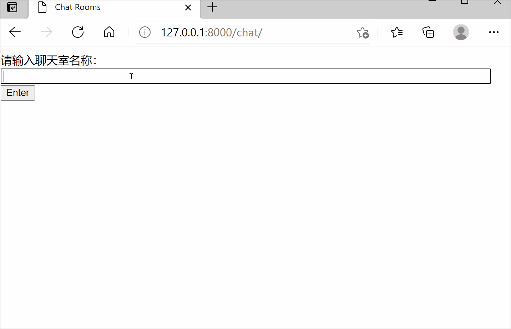
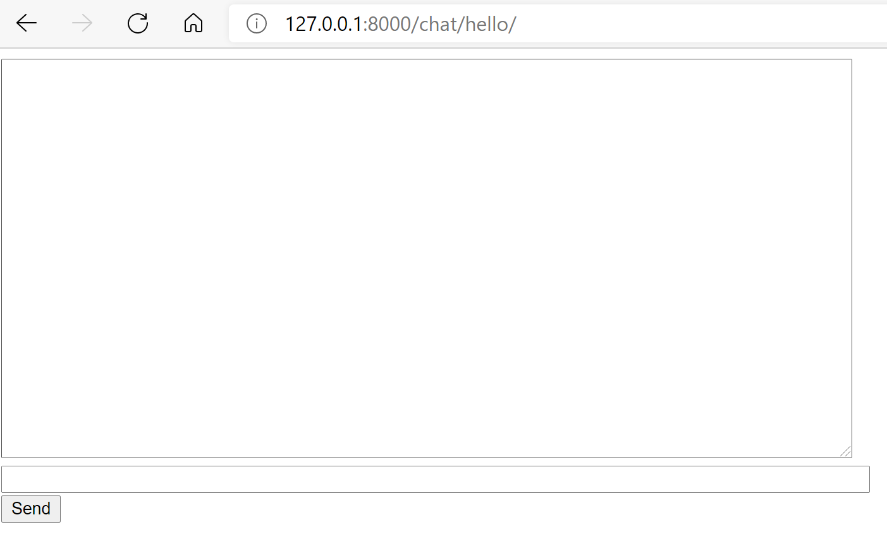
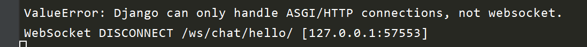

# Django实战：channels + websocket四步打造个在线聊天室(附图)
Channels是Django团队研发的一个给Django提供websocket支持的框架，它同时支持http和websocket多种协议。使用channels可以让你的Django应用拥有实时通讯和给用户主动推送信息的功能。本文将教你如何使用channels + websocket打造个在线聊天室。一共只有四步，你可以轻松上手学会。项目中大部分代码是基于channels的官方文档的，加入了自己的理解，以便新手学习使用。
{: .fs-6 .fw-300 }

{: .no_toc }

## 目录
{: .no_toc .text-delta }

1. TOC
{:toc}

---

## Websocket基础知识
WebSocket 是 HTML5 开始提供的一种在单个 TCP 连接上进行全双工通讯的协议。WebSocket 使得客户端和服务器之间的数据交换变得更加简单，允许服务端主动向客户端推送数据。在 WebSocket API 中，浏览器和服务器只需要完成一次握手，两者之间就直接可以创建持久性的连接，并进行双向数据传输。

很多网站为了实现推送技术，所用的技术都是 Ajax 轮询。轮询是在特定的的时间间隔（如每1秒），由浏览器对服务器发出HTTP请求，然后由服务器返回最新的数据给客户端的浏览器。这种传统的模式带来很明显的缺点，即浏览器需要不断的向服务器发出请求，然而HTTP请求可能包含较长的头部，其中真正有效的数据可能只是很小的一部分，显然这样会浪费很多的带宽等资源。Websocket能更好的节省服务器资源和带宽，并且能够更实时地进行通讯，早已成为一种非常流行必须掌握的技术。

以上关于websocket介绍来自菜鸟教程，更多内容见菜鸟教程(https://www.runoob.com/)。现在就让我们步入正题吧，利用Django + channels实现websocket编写个在线聊天室，一共只有四步。跟着学，你可以实现。江哥出品，必出精品。

演示效果如下所示：



## 第一步 准备工作
首先在虚拟环境中安装`django`和`channels`(本项目使用了最新版本，均为3.X版本), 新建一个名为`myproject`的项目，新建一个app名为`chat`。如果windows下安装报错，如何解决自己网上去找吧。

```bash
pip install django==3.2.3
pip install channels==3.0.3
```
修改`settings.py`, 将`channels`和`chat`加入到`INSTALLED_APPS`里，并添加相应配置，如下所示：
```python
INSTALLED_APPS = [
      'django.contrib.admin',
      'django.contrib.auth',
      'django.contrib.contenttypes',
      'django.contrib.sessions',
      'django.contrib.messages',
      'django.contrib.staticfiles',
      'channels', # channels应用
      'chat',   
]

# 设置ASGI应用
ASGI_APPLICATION = 'myproject.asgi.application'

# 设置通道层的通信后台 - 本地测试用
CHANNEL_LAYERS = {
    "default": {
        "BACKEND": "channels.layers.InMemoryChannelLayer"
    }
}
```

**注意 **：本例为了简化代码，使用了`InMemoryChannelLayer`做通道层(channel_layer)的通信后台，实际生产环境中应该需要使用redis作为后台。这时你还需要安装`redis`和`channels_redis`，然后添加如下配置：

```python
# 生产环境中使用redis做后台，安装channels_redis
CHANNEL_LAYERS = {
    "default": {
        "BACKEND": "channels_redis.core.RedisChannelLayer",
        "CONFIG": {
            "hosts": [("127.0.0.1", 6379)],
             #或"hosts": [os.environ.get('REDIS_URL', 'redis://127.0.0.1:6379/1')],
        },
    },
}
```

最后将`chat`应用的`urls.py`加入到项目`urls.py`中去，这和常规Django项目无异。

```python
# myproject/urls.py

from django.conf.urls import include
from django.urls import path
from django.contrib import admin

urlpatterns = [
    path('chat/', include('chat.urls')),
    path('admin/', admin.site.urls),
]
```

## 第二步 编写聊天室页面

我们需要利用django普通视图函数编写两个页面，一个用于展示首页(index), 通过表单让用户输入聊天室的名称(`room_name`)，然后跳转到相应聊天室页面；一个页面用于实时展示聊天信息记录，并允许用户发送信息。

这两个页面对应的路由及视图函数如下所示：

```python
# chat/urls.py
from django.urls import path
from . import views

urlpatterns = [
    path('', views.index, name='index'),
    path('<str:room_name>/', views.room, name='room'),
]

# chat/views.py
from django.shortcuts import render

def index(request):
    return render(request, 'chat/index.html', {})

def room(request, room_name):
    return render(request, 'chat/room.html', {
        'room_name': room_name
    })
```

接下来我们编写两个模板文件`index.html`和`room.html`。它们的路径位置如下所示：

```html
chat/
    __init__.py
    templates/
        chat/
            index.html
            room.html
    urls.py
    views.py
```

`index.html`内容如下所示。它也基本不涉及websocket，就是让用户输入聊天室后进行跳转。

```html
<!-- chat/templates/chat/index.html -->
<!DOCTYPE html>
<html>
<head>
    <meta charset="utf-8"/>
    <title>Chat Rooms</title>
</head>
<body>
    请输入聊天室名称：
    <input id="room-name-input" type="text" size="100">
    <input id="room-name-submit" type="button" value="Enter">

    <script>
        document.querySelector('#room-name-input').focus();
        document.querySelector('#room-name-input').onkeyup = function(e) {
            if (e.keyCode === 13) {  // enter, return
                document.querySelector('#room-name-submit').click();
            }
        };

        document.querySelector('#room-name-submit').onclick = function(e) {
            var roomName = document.querySelector('#room-name-input').value;
            window.location.pathname = '/chat/' + roomName + '/';
        };
    </script>
</body>
</html>
```

`room.html`内容如下所示。为了帮助你理解前后端是怎么实现websocket实时通信的，我给每行js代码添加了注释，这对于你理解前端如何发送websocket的请求，如果处理后端发过来的websocket消息至关重要。

```javascript
  <script>
       // 获取房间名
       const roomName = JSON.parse(document.getElementById('room-name').textContent);

       // 根据roomName拼接websocket请求地址，建立长连接
       //  请求url地址为/ws/chat/<room_name>/
       const wss_protocol = (window.location.protocol == 'https:') ? 'wss://': 'ws://';
       const chatSocket = new WebSocket(
            wss_protocol + window.location.host + '/ws/chat/'  + roomName + '/'
            );

       // 建立websocket连接时触发此方法，展示欢迎提示
       chatSocket.onopen = function(e) {
            document.querySelector('#chat-log').value += ('[公告]欢迎来到' + roomName + '讨论群。请文明发言!\n')
        }

       // 从后台接收到数据时触发此方法
       // 接收到后台数据后对其解析，并加入到聊天记录chat-log
        chatSocket.onmessage = function(e) {
            const data = JSON.parse(e.data);
            document.querySelector('#chat-log').value += (data.message + '\n');
        };
 
        // websocket连接断开时触发此方法
        chatSocket.onclose = function(e) {
            console.error('Chat socket closed unexpectedly');
        };
        
        document.querySelector('#chat-message-input').focus();
        document.querySelector('#chat-message-input').onkeyup = function(e) {
            if (e.keyCode === 13) {  // enter, return
                document.querySelector('#chat-message-submit').click();
            }
        };
        
        // 每当点击发送消息按钮，通过websocket的send方法向后台发送信息。
        document.querySelector('#chat-message-submit').onclick = function(e) {
            const messageInputDom = document.querySelector('#chat-message-input');
            const message = messageInputDom.value;
            
            //注意这里:先把文本数据转成json格式,然后调用send方法发送。
            chatSocket.send(JSON.stringify({
                'message': message
            }));
            messageInputDom.value = '';
        };
    </script>
```

此时如果你使用`python manage.py runserver`命令启动测试服务器，当你访问一个名为/hello/的房间时，你将看到如下页面：



到这里你看不到任何聊天记录，也不能发送任何消息，因为我们还没有在后端编写任何代码用于处理前端发来的消息，并返回数据。在终端你还会看到如下报错,  说Django只能处理http连接，不能处理websocket。



到目前为止，我们所写的就是一个普通的django应用，还没有用到`channels`库处理websocket请求。接下来我们就要正式开始使用`channels了`。

## 第三步 编写后台websocket路由及处理方法

当 Django 接受 HTTP 请求时, 它会根据根 URLconf 以查找视图函数, 然后调用视图函数来处理请求。同样, 当 channels 接受 WebSocket 连接时, 它也会根据根路由配置去查找相应的处理方法。只不过channels的路由不在urls.py中配置，处理方法也不写在views.py。在channels中，这两个文件分别变成了`routing.py`和`consumers.py`。这样的好处是不用和django的常规应用混在一起。

- `routing.py`：websocket路由文件，相当于django的`urls.py`。它根据websocket请求的url地址触发`consumers.py`里定义的方法。

- `consumers.py`：相当于django的视图`views.py`，负责处理通过websocket路由转发过来的请求和数据。

在`chat`应用下新建`routing.py`, 添加如下代码。它的作用是将发送至`ws/chat/<room_name>/`的websocket请求转由`ChatConsumer`处理。

```python
# chat/routing.py
from django.urls import re_path

from . import consumers

websocket_urlpatterns = [
    re_path(r'ws/chat/(?P<room_name>\w+)/$', consumers.ChatConsumer.as_asgi()),
]
```

注意：定义websocket路由时，推荐使用常见的路径前缀 (如/ws) 来区分 WebSocket 连接与普通 HTTP 连接， 因为它将使生产环境中部署 Channels 更容易，比如nginx把所有/ws的请求转给channels处理。

与Django类似，我们还需要把这个app的websocket路由加入到项目的根路由中去。编辑`myproject/asgi.py`, 添加如下代码：

```python
# myproject/asgi.py
import os

from channels.auth import AuthMiddlewareStack
from channels.routing import ProtocolTypeRouter, URLRouter
from django.core.asgi import get_asgi_application
import chat.routing

os.environ.setdefault("DJANGO_SETTINGS_MODULE", "myproject.settings")

application = ProtocolTypeRouter({
   # http请求使用这个
  "http": get_asgi_application(),
  
  # websocket请求使用这个
  "websocket": AuthMiddlewareStack(
        URLRouter(
            chat.routing.websocket_urlpatterns
        )
    ),
})
```

在这里，channels的`ProtocolTypeRouter`会根据请求协议的类型来转发请求。`AuthMiddlewareStack `将使用对当前经过身份验证的用户的引用来填充连接的`scope`, 类似于 Django 的`request`对象，我们后面还会讲到。

接下来在`chat`应用下新建`consumers.py`, 添加如下代码:

```python
import json
from asgiref.sync import async_to_sync
from channels.generic.websocket import WebsocketConsumer
import datetime


class ChatConsumer(WebsocketConsumer):
    # websocket建立连接时执行方法
    def connect(self):
        # 从url里获取聊天室名字，为每个房间建立一个频道组
        self.room_name = self.scope['url_route']['kwargs']['room_name']
        self.room_group_name = 'chat_%s' % self.room_name

        # 将当前频道加入频道组
        async_to_sync(self.channel_layer.group_add)(
            self.room_group_name,
            self.channel_name
        )

        # 接受所有websocket请求
        self.accept()

    # websocket断开时执行方法
    def disconnect(self, close_code):
        async_to_sync(self.channel_layer.group_discard)(
            self.room_group_name,
            self.channel_name
        )

    # 从websocket接收到消息时执行函数
    def receive(self, text_data):
        text_data_json = json.loads(text_data)
        message = text_data_json['message']

        # 发送消息到频道组，频道组调用chat_message方法
        async_to_sync(self.channel_layer.group_send)(
            self.room_group_name,
            {
                'type': 'chat_message',
                'message': message
            }
        )

    # 从频道组接收到消息后执行方法
    def chat_message(self, event):
        message = event['message']
        datetime_str = datetime.datetime.now().strftime('%Y-%m-%d %H:%M:%S')

        # 通过websocket发送消息到客户端
        self.send(text_data=json.dumps({
            'message': f'{datetime_str}:{message}'
        }))
```

每个自定义的Consumer类一般继承同步的`WebsocketConsumer`类或异步的`AysncWebSocketConsumer`类，它自带 `self.channel_name` 和`self.channel_layer` 属性。前者是独一无二的长连接频道名，后者提供了 `send()`, `group_send()`和`group_add()` 3种方法, 可以给单个频道或一个频道组发信息，还可以将一个频道加入到组。

- 每个频道(channel)都有一个名字。拥有频道名称的任何人都可以向频道发送消息。
- 一个组(group)有一个名字。具有组名称的任何人都可以按名称向组添加/删除频道，并向组中的所有频道发送消息。

**注意**：虽然异步Consumer类性能更优，channels推荐使用同步consumer类 , 尤其是调用Django ORM或其他同步程序时，以保持整个consumer在单个线程中并避免ORM查询阻塞整个event。调用`channel_layer`提供的方法时需要用` async_to_sync`转换一下。

在本例中，我们还使用了`self.scope['url_route']['kwargs']['room_name']`从路由中获取了聊天室的房间名，在channels程序中，scope是个很重要的对象，类似于django的request对象，它代表了当前websocket连接的所有信息。你可以通过`scope['user']`获取当前用户对象，还可以通过`scope['path']`获取当前当前请求路径。

## 第四步 运行看效果

连续运行如下命令，就可以看到我们文初的效果啦。

```python
python manage.py makemigrations
python manage.py migrate
python manage.py runserver
```

## 小结

我们已经使用django + channels 写了个在线聊天小应用了，现在来总结下我们所学的知识吧。

- websocket属于全双工通讯的协议，可以在服务器和客户端之间保持长连接，实现双向数据传输。
- 前端websocket对象可以通过`onmessage`监听并处理后端返回的数据，可以通过`send`方法向后端发送数据。
- channels对应websocket的路由和处理方法分别写在`routing.py`和`consumers.py`文件里，相当于django的`urls.py`和`views.py`。
- 每个频道(channel)都有一个名字，拥有频道名称的任何人都可以向频道发送消息。一个组(group)有一个名字，可以包含多个频道。
- 每个自定义的Consumer类自带 `self.channel_name` 和`self.channel_layer` 属性。前者是独一无二的频道名，后者提供了 `send()`, `group_send()`和`group_add()` 3种方法。
- 在channels程序中，scope是个很重要的对象，类似于django的request对象，它代表了当前websocket连接的所有信息，比如`scope['user']`, `scope['path']`。

我是大江狗，一名Python Web技术开发爱好者。您可以通过搜索【<a href="https://blog.csdn.net/weixin_42134789">CSDN大江狗</a>】、【<a href="https://www.zhihu.com/people/shi-yun-bo-53">知乎大江狗</a>】和搜索微信公众号【Python Web与Django开发】关注我！