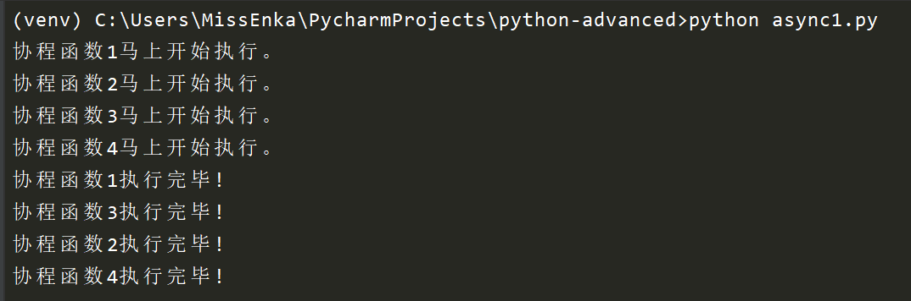
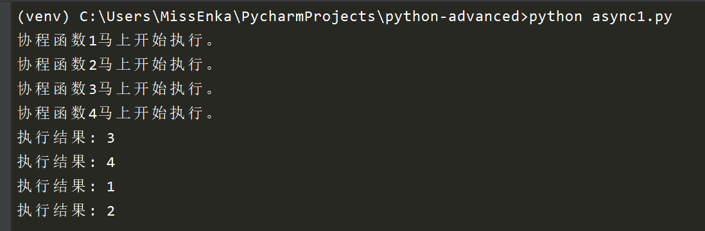
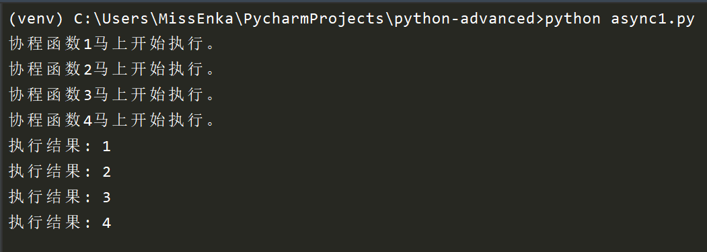

# Python协程asyncio模块的演变及高级用法
{: .no_toc }

## 目录
{: .no_toc .text-delta }

1. TOC
{:toc}

---
网上很多关于Python协程asyncio模块的教程都是基于老版Python的, 本文将以对比方式展示新老Python版本下协程的写法有什么不同并总结asyncio的一些高级用法。
{: .fs-6 .fw-300 }

## Python协程及asyncio基础知识

协程(coroutine)也叫微线程，是实现多任务的另一种方式，是比线程更小的执行单元，一般运行在单进程和单线程上。因为它自带CPU的上下文，它可以通过简单的事件循环切换任务，比进程和线程的切换效率更高，这是因为进程和线程的切换由操作系统进行。

Python实现协程的主要借助于两个库：`asyncio`和`gevent`。由于asyncio已经成为python的标准库了无需pip安装即可使用，这意味着`asyncio`作为Python原生的协程实现方式会更加流行。本文仅会介绍`asyncio`模块。如果大家对`gevent`也有需求，请留言，我会单独写篇文章介绍这个库的使用。

`asyncio` 是从Python3.4引入的标准库，直接内置了对协程异步IO的支持。asyncio 的编程模型本质是一个消息循环，我们一般先定义一个协程函数(或任务), 从 asyncio 模块中获取一个 EventLoop 的引用，然后把需要执行的协程任务(或任务列表)扔到 EventLoop 中执行，就实现了异步IO。当处理流出现IO阻塞时，线程并不会等待IO操作执行完，而是去EventLoop中执行下一个协程。

## 定义协程函数及执行方法的演变

在最早的Python 3.4中，协程函数是通过`@asyncio.coroutine` 和 `yeild from` 实现的, 如下所示。

```python
import asyncio

@asyncio.coroutine
def func1(i):
    print("协程函数{}马上开始执行。".format(i))
    yield from asyncio.sleep(2)
    print("协程函数{}执行完毕!".format(i))

if __name__ == '__main__':
    # 获取事件循环
    loop = asyncio.get_event_loop()

    # 执行协程任务
    loop.run_until_complete(func1(1))

    # 关闭事件循环
    loop.close()
```

这里我们定义了一个`func1`的协程函数，我们可以使用`asyncio.iscoroutinefunction `来验证。定义好协程函数后，我们首先获取事件循环loop，使用它的`run_until_complete`方法执行协程任务，然后关闭loop。

```python
print(asyncio.iscoroutinefunction(func1(1))) # True
```

Python 3.5以后引入了`async/await` 语法定义协程函数，代码如下所示。每个协程函数都以`async`声明，以区别于普通函数，对于耗时的代码或函数我们使用`await`声明，表示碰到等待时挂起，以切换到其它任务。

```python
import asyncio

# 这是一个协程函数
async def func1(i):
    print("协程函数{}马上开始执行。".format(i))
    await asyncio.sleep(2)
    print("协程函数{}执行完毕!".format(i))

if __name__ == '__main__':
    # 获取事件循环
    loop = asyncio.get_event_loop()

    # 执行协程任务
    loop.run_until_complete(func1(1))

    # 关闭事件循环
    loop.close()
```

Python 3.7之前执行协程任务都是分三步进行的，代码有点冗余。Python 3.7提供了一个更简便的`asyncio.run`方法，上面代码可以简化为：

```python
import asyncio

async def func1(i):
    print(f"协程函数{i}马上开始执行。")
    await asyncio.sleep(2)
    print(f"协程函数{i}执行完毕!")

if __name__ == '__main__':
    asyncio.run(func1(1))
```

注：Python自3.6版本起可以使用f-string来对字符串进行格式化了，相当于format函数的简化版。

## 创建协程任务的演变

前面的演示案例中，我们只执行了单个协程任务(函数)。实际应用中，我们先由协程函数创建协程任务，然后把它们加入协程任务列表，最后一起交由事件循环执行。

根据协程函数创建协程任务有多种方法，其中最新的是Python 3.7版本提供的`asyncio.create_task`方法，如下所示：

```python
# 方法1：使用ensure_future方法。future代表一个对象，未执行的任务。
task1 = asyncio.ensure_future(func1(1))
task2 = asyncio.ensure_future(func1(2))

# 方法2：使用loop.create_task方法
task1 = loop.create_task(func1(1))
task2 = loop.create_task(func1(2))

# 方法3：使用Python 3.7提供的asyncio.create_task方法
task1 = asyncio.create_task(func1(1))
task2 = asyncio.create_task(func1(2))
```

创建多个协程任务列表后，我们还要使用`asyncio.wait`方法收集协程任务，并交由事件循环处理执行。

```python
import asyncio

async def func1(i):
    print(f"协程函数{i}马上开始执行。")
    await asyncio.sleep(2)
    print(f"协程函数{i}执行完毕!")


async def main():
    tasks = []
    # 创建包含4个协程任务的列表
    for i in range(1, 5):
        tasks.append(asyncio.create_task(func1(i)))
        
    await asyncio.wait(tasks)

if __name__ == '__main__':
    asyncio.run(main())
```

执行效果如下所示，你会发现4个协程任务并不是按顺序执行的。



对于收集多个协程任务，Python还提供了新的`asyncio.gather`方法，它的作用`asyncio.wait`方法类似，但更强大。如果列表中传入的不是`create_task`方法创建的协程任务，它会自动将函数封装成协程任务，如下所示：

```python
import asyncio

async def func1(i):
    print(f"协程函数{i}马上开始执行。")
    await asyncio.sleep(2)
    print(f"协程函数{i}执行完毕!")

async def main():
    tasks = []
    for i in range(1, 5):
        # 这里未由协程函数创建协程任务
        tasks.append(func1(i))
        
    # 注意这里*号。gather自动将函数列表封装成了协程任务。
    await asyncio.gather(*tasks)

if __name__ == '__main__':
    asyncio.run(main())
```

## asyncio.gather和asyncio.wait的区别

是的，`gather`方法有将函数封装成协程任务的能力，但这还并不是两者最主要的区别。两者更大的区别在协程任务执行完毕后对于返回结果的处理上。通常获取任务执行结果通常对于一个程序至关重要，因此我们有必要花更多时间详细了解这两个方法的使用。

`asyncio.wait` 会返回两个值：`done` 和 `pending`，`done` 为已完成的协程任务列表，`pending` 为超时未完成的协程任务类别，需通过`task.result()`方法可以获取每个协程任务返回的结果；而`asyncio.gather` 返回的是所有已完成协程任务的 `result`，不需要再进行调用或其他操作，就可以得到全部结果。

我们来看两个示例。现在修改我们的协程函数，通过return给它增加一个返回值。

### 通过asyncio.wait获取协程任务执行结果

```python
import asyncio

async def func1(i):
    print(f"协程函数{i}马上开始执行。")
    await asyncio.sleep(2)
    return i

async def main():
    tasks = []
    for i in range(1, 5):
        tasks.append(asyncio.create_task(func1(i)))
        
    # 获取任务执行结果。
    done, pending = await asyncio.wait(tasks)
    for task in done:
        print(f"执行结果: {task.result()}")

if __name__ == '__main__':
    asyncio.run(main())
```

执行结果如下所示。你可以看到协程任务执行结果并不是按任务添加的顺序返回的。



### 通过asyncio.gather获取协程任务执行结果

继续修改我们的代码：

```python
#-*- coding:utf-8 -*-
import asyncio

async def func1(i):
    print(f"协程函数{i}马上开始执行。")
    await asyncio.sleep(2)
    return i

async def main():
    tasks = []
    for i in range(1, 5):
        tasks.append(func1(i))

    results = await asyncio.gather(*tasks)
    for result in results:
        print(f"执行结果: {result}")

if __name__ == '__main__':
    asyncio.run(main())
```

执行结果如下所示。协程任务执行结果与任务添加顺序完全一致。



现在你知道gather和wait方法的真正区别了吗？ 

- gather具有把普通协程函数包装成协程任务的能力，wait没有。wait只能接收包装后的协程任务列表做参数。
- 两者返回值不一样，wait返回的是已完成和未完成任务的列表，而gather直接返回协程任务执行结果。
- gather返回的任务执行结果是有序的，wait方法获取的结果是无序的。

## asyncio高级使用方法

### 给任务添加回调函数

我们还可以给每个协程任务通过`add_done_callback `的方法给单个协程任务添加回调函数，如下所示：

```python
#-*- coding:utf-8 -*-
import asyncio

async def func1(i):
    print(f"协程函数{i}马上开始执行。")
    await asyncio.sleep(2)
    return i

# 回调函数
def callback(future):
    print(f"执行结果:{future.result()}")

async def main():
    tasks = []
    for i in range(1, 5):
        task = asyncio.create_task(func1(i))
        
        # 注意这里，增加回调函数
        task.add_done_callback(callback)
        tasks.append(task)

    await asyncio.wait(tasks)

if __name__ == '__main__':
    asyncio.run(main())
```

### 设置任务超时

很多协程任务都是很耗时的，当你使用wait方法收集协程任务时，可通过timeout选项设置任务切换前单个任务最大等待时间长度，如下所示

```python
 # 获取任务执行结果，如下所示：
 done, pending = await asyncio.wait(tasks, timeout=10)
```

### 自省

- `asyncio.current_task`: 返回当前运行的`Task`实例，如果没有正在运行的任务则返回 `None`。如果 *loop* 为 `None` 则会使用 `get_running_loop()`获取当前事件循环。

- `asyncio.all_tasks`: 返回事件循环所运行的未完成的`Task`对象的集合。

## 小结

本文将以对比方式展示新老Python版本下协程的写法有什么不同并总结asyncio的一些高级用法，包括gather和wait方法的区别。

感谢大家过去的支持和关注。我是大江狗，一名Python Web技术开发爱好者。您可以通过搜索【<a href="https://blog.csdn.net/weixin_42134789">CSDN大江狗</a>】、【<a href="https://www.zhihu.com/people/shi-yun-bo-53">知乎大江狗</a>】和搜索微信公众号【Python Web与Django开发】关注我！