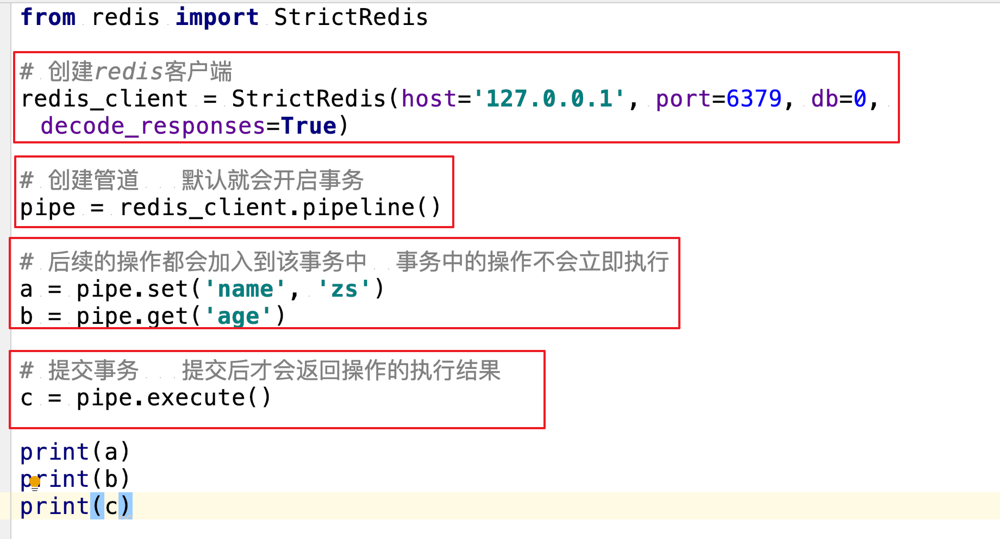
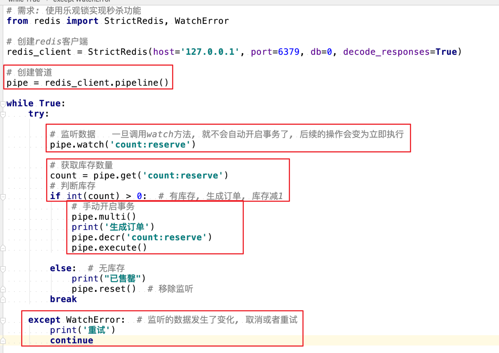
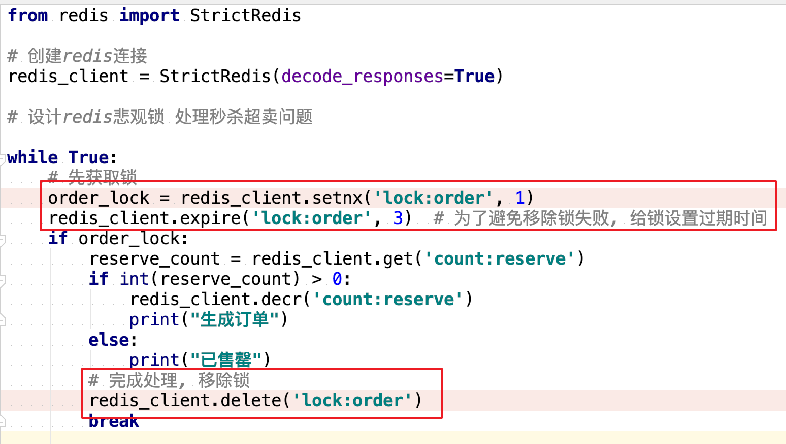
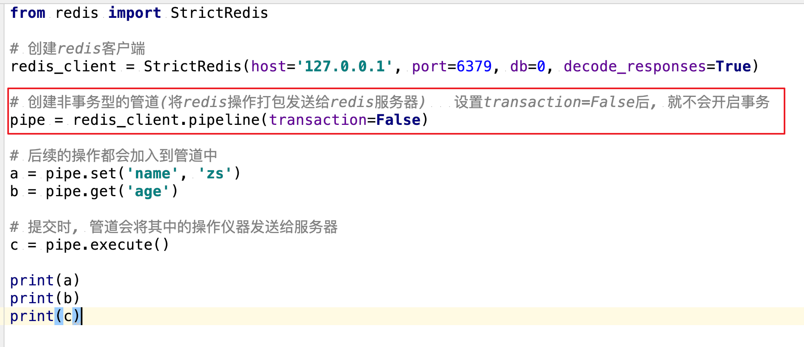

# Redis使用教程
{: .no_toc }

## 目录
{: .no_toc .text-delta }

1. TOC
{:toc}

---


RDB 快照存储

- 将内存中的所有数据完整的保存到硬盘中
- 机制
  - fork出一个子进程,专门进行数据持久化, 将内存中所有数据保存到单个rdb文件中(默认为dump.rdb)
  - redis重启后, 会加载rdb文件中的数据到内存中
- 触发方式
  - 配置中设置自动持久化策略
  - SAVE | BGSAVE | SHUTDOWN (前提是设置了自动持久化策略)
- 相关配置

```
      save 60 1000  # 多久执行一次自动快照操作 60秒内如果更新了1000次, 则持久化一次
      stop-writes-on-bgsave-error no  # 创建快照失败后,是否继续执行写命令
      rdbcompression yes  # 是否对快照文件进行压缩
      dbfilename dump.rdb  # 如何命名快照文件
      dir ./ # 快照文件保存的位置
    
      save   # 关闭RDB机制
```

- 优缺点
  - 优点
    - 方便数据备份: 由于保存到单独的文件中, 易于数据备份 (可以使用定时任务, 定时将文件发送给数据备份中心)
    - 写时复制: 子进程单独完成持久化操作, 父进程不参与IO操作, 最大化redis性能
    - 恢复大量数据时, 速度优于 AOF
  - 缺点
    - 不是实时保存数据, 如果redis意外停止工作(如电源断电等), 则可能会丢失一段时间的数据
    - 数据量大时, fork进程会比较慢, 持久化时使redis响应速度变慢

1.3.2 AOF 只追加文件

- Append-only file 只追加文件
  - 只追加 而 不是全部重新写入
  - 追加命令, 而不是数据
- 机制
  - 主线程将 写命令 追加到aof_buf(缓冲区)中, 根据使用的策略不同, 子线程 将缓存区的命令写入到aof文件中 (不使用子进程)
  - 当redis重启时, 会重新执行aof文件中的命令来恢复数据
    - 如果同时开启了 RDB, 则优先使用 AOF
- 文件修复
  - 如果AOF出错 (磁盘满了/写入中途宕机等), 则redis重启时会拒绝使用该AOF文件
  - 修复步骤
    - 首先备份AOF文件
    - 使用redis-check-aof工具进行修复 (一般会删除末尾无法恢复的命令)
    - 重启redis服务器, 自动载入修复后的AOF文件, 进行数据恢复

```
      $ redis-check-aof –fix
      # 可选操作: 使用 diff -u 对比修复后的 AOF 文件和原始 AOF 文件的备份，查看两个文件之间的不同之处。
```

- 文件重写/压缩
  - AOF 提供了重写/压缩机制(优化命令), 以避免AOF文件过大
  - fork子进程来完成 AOF 重写
- 相关配置

```
    appendonly no  # 是否开启AOF机制
    appendfsync everysec  # 多久将写入的内容同步到硬盘 每秒一次
    no-appendfsync-on-rewirete no  # 重写aof文件时是否执行同步操作
    auto-aof-rewrite-percentage 100  # 多久执行一次aof重写, 当aof文件的体积比上一次重写后的aof文件大了一倍时
    auto-aof-rewrite-min-size 64mb  # 多久执行一次aof重写,当aof文件体积大于64mb时
    
    appendfilename appendonly.aof  # aof文件名
    dir ./  # aof文件保存的位置(和rdb文件共享该配置)
```

- 优缺点
  - 优点
    - 更可靠 默认每秒同步一次操作, 最多丢失一秒数据
      - 提供了三种策略, 还可以自动同步/每次写同步/每秒同步
    - 可以进行文件重写, 以避免AOF文件过大
  - 缺点
    - 相同数据集, AOF文件比RDB体积大, 恢复速度慢

1.3.3 如何选择

- 对于更新频繁, 一致性要求不是非常高的数据 可以选择使用redis进行持久化存储
- RDB or AOF
  - 数据安全性要求高, 都打开
  - 可以接受短时间的数据丢失, 只使用 RDB
  - 即使使用 AOF, 最好也开启 RDB, 因为便于备份并且回复速度快, bug更少
- 项目中的应用
  - 使用redis进行一部分数据的持久化存储
    - 用户的阅读历史/搜索历史
  - 两种持久化机制都开启了

标签: [Redis](https://www.cnblogs.com/oklizz/tag/Redis/)


# [redis--事务](https://www.cnblogs.com/oklizz/p/11414318.html)

- 语法
  - MULTI
    - 开启事务, 后续的命令会被加入到同一个事务中
    - 事务中的操作会发给服务端, 但是不会立即执行, 而是放到了该事务的对应的一个队列中, 服务端返回QUEUED
  - EXEC
    - 执行EXEC后, 事务中的命令才会被执行
    - 事务中的命令出现错误时, 不会回滚也不会停止事务, 而是继续执行
  - DISCARD
    - 取消事务, 事务队列会清空, 客户端退出事务状态
- ACID
  - 原子性
    - 不支持
    - 不会回滚并且继续执行
  - 隔离性
    - 支持
    - 事务中命令顺序执行, 并且不会被其他客户端打断 (先EXEC的先执行)
    - 单机redis读写操作使用单进程单线程
  - 持久性
    - 不支持, redis数据易丢失
  - 一致性
    - 不支持
    - 强一致性要求 通过乐观锁(watch)来实现
      

WATCH

- redis实现的乐观锁
- 机制
  - 事务开启前, 设置对数据的监听, EXEC时, 如果发现数据发生过修改, 事务会自动取消(DISCARD)
  - 事务EXEC后, 无论成败, 监听会被移除

```sql
WATCH mykey  # 监视mykey的值
MULTI  # 开启事务
SET mykey 10  
EXEC  # 如果mykey的值在执行exec之前发生过改变, 则该事务会取消(客户端可以在发生碰撞后不断重试)
```



**setnx和悲观锁**

- setnx 键不存在,才会设置成功



- 非事务型管道
  